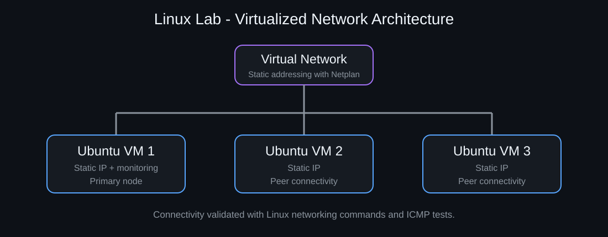
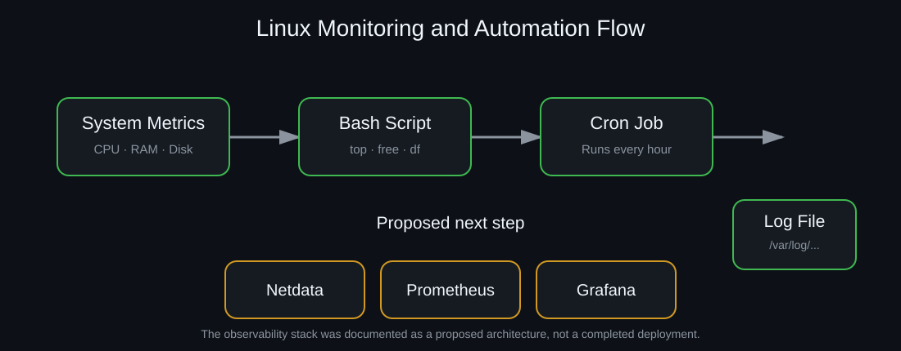

# 🖥️ Linux Infrastructure & Monitoring Lab

University group project adapted into a Linux and cybersecurity portfolio case study.

## Overview

The project used three Linux virtual machines configured on the same network. The practical work included VM cloning, static IP configuration with Netplan, connectivity validation, Linux command-line administration, users and groups, system monitoring, scheduled tasks and network/service inspection.

The final section of the academic project also proposed a centralized monitoring architecture using Netdata, Prometheus and Grafana. That observability stack is documented here as a **proposed architecture**, not as a completed deployment.

## Visual Overview



The diagram summarizes the implemented three-VM lab and the static networking configuration performed with Netplan.



The monitoring visual separates the implemented Bash/cron workflow from the proposed Netdata → Prometheus → Grafana architecture.

## Project Structure

- [Virtualization and Networking](./virtualization-and-networking.md)
- [Linux Administration](./linux-administration.md)
- [Monitoring and Automation](./monitoring-and-automation.md)
- [Users, Groups and Network Inspection](./users-groups-network.md)
- [Proposed Observability Stack](./observability-stack.md)

## Skills Demonstrated

- Linux virtual machine administration
- Static IPv4 configuration with Netplan
- Connectivity testing with `ping`
- File and directory management
- Pipes and I/O redirection
- `grep`, regular expressions and `find`
- Process and memory monitoring
- Scheduled monitoring with `cron`
- User and group administration
- Network inspection with `ip a` and `ss -tunlp`
- Basic infrastructure monitoring concepts
- Prometheus/Grafana architecture planning

## Lab Progression

```text
3 Ubuntu VMs
     ↓
Static networking with Netplan
     ↓
Linux administration fundamentals
     ↓
Process / memory / kernel monitoring
     ↓
Cron-based monitoring automation
     ↓
Users, groups and open-port inspection
     ↓
Proposed centralized observability
Netdata → Prometheus → Grafana
```

## Project Context

This was a university group project. This portfolio version focuses on the Linux administration, networking, monitoring and cybersecurity-relevant portions of the work. Personal information from the original academic document is intentionally omitted.
