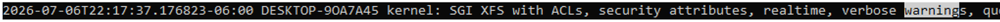
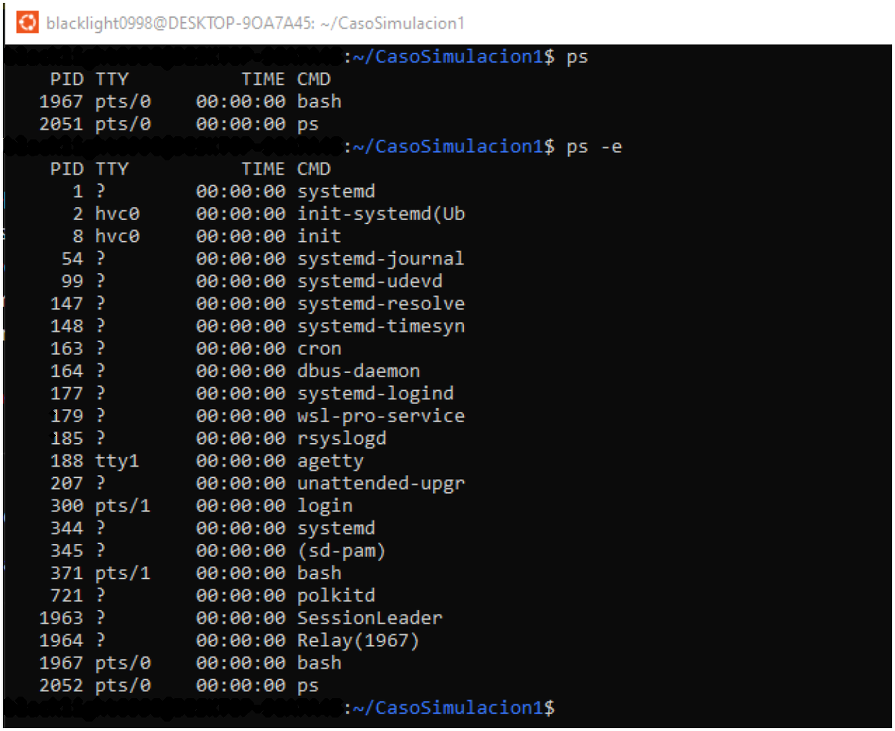
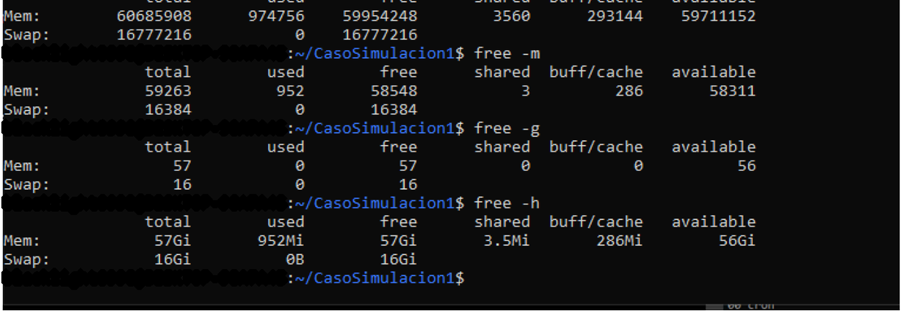

# Phase 3 — Linux System Diagnosis & Log Analysis

This section is part of the broader [Linux Security Administration & Monitoring Lab](../).

It applies Linux administration knowledge to troubleshooting and basic investigation.

## What I worked on

- Reviewing `auth.log`, `kern.log` and `dmesg`
- Checking failed authentication attempts
- Reviewing kernel warnings in a virtualized environment
- Inspecting running processes with `ps`
- Monitoring CPU and processes with `top`
- Reviewing memory usage with `free`
- Writing basic conclusions from the evidence collected

## Main findings

During the activity I found failed authentication attempts in `auth.log`, but they did not appear to be the cause of the simulated performance issue.

Kernel messages included warnings related to WSL2 and Hyper-V. These were treated as virtualization-related messages instead of assuming they were a system failure.

The process and memory checks did not show abnormal resource consumption. CPU usage was low and the system had a large amount of available memory.

## Why this matters for security

The lab helped me practice checking logs and system activity before making assumptions about an incident. It also showed me how commands such as `ps`, `top`, `free` and `dmesg` can support troubleshooting and basic investigation.

## Evidence

### Kernel warnings

### Process analysis

### Real-time monitoring with top

### Memory analysis

The screenshots come from the original Ubuntu activity. Personal system identifiers were removed before publishing them in the portfolio.

## Project context

This activity came from the Basic Operating Systems course at Universidad Fidélitas and is presented here as the diagnosis and investigation phase of the larger Linux portfolio project.
