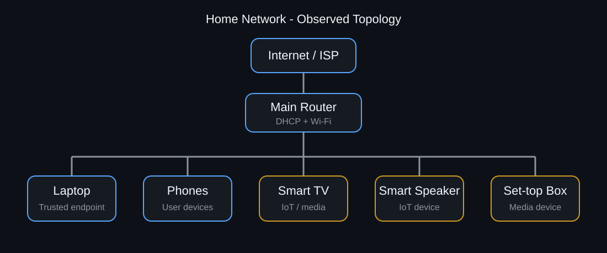
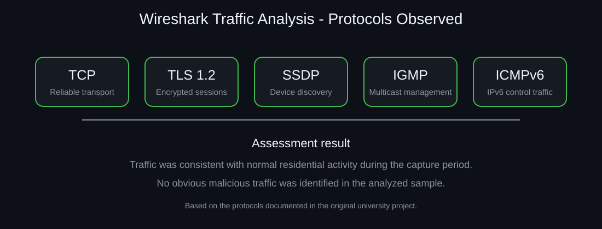

# 🏠 Home Network Security & Traffic Analysis

University group project adapted into a cybersecurity portfolio case study.

## Project Overview

This project documents the assessment of a real residential network with the objective of understanding its infrastructure, validating connectivity, reviewing wireless security, analyzing network traffic and identifying potential security weaknesses.

The original academic work covered device inventory, IPv4 addressing, DHCP, connectivity testing, wireless security, bandwidth measurement, Wireshark traffic analysis, redundancy, vulnerability identification and network topology.

All household-specific personal details and unnecessary identifiers have been omitted from this portfolio version.

## Visual Overview



The visual above recreates the documented residential topology without exposing household-specific identifiers.



The protocol visual summarizes the traffic types documented during the Wireshark analysis without publishing raw network identifiers.

## Project Structure

| Section | Description |
|---|---|
| [Network Architecture](./network-architecture.md) | Devices, IPv4 layout, DHCP and current vs. improved topology |
| [Connectivity & Performance](./connectivity-tests.md) | Gateway, Internet, DNS, `tracert` and bandwidth validation |
| [Wireshark Analysis](./wireshark-analysis.md) | TCP, TLS 1.2, SSDP, IGMP and ICMPv6 observations |
| [Security Findings](./security-findings.md) | Segmentation, IoT exposure, wireless security and availability risks |
| [Recommendations](./recommendations.md) | Practical hardening and segmentation improvements |

## Environment

The assessed network contained:

- Fiber Internet connection
- Wireless router providing routing, Wi-Fi and DHCP
- Laptop
- Three mobile devices
- Smart TV / set-top box
- IoT smart speaker

## Tools and Techniques

- Wireshark
- Cisco Packet Tracer
- `ipconfig`
- `ping`
- `tracert`
- Speedtest
- IPv4 addressing analysis
- DHCP analysis
- Wireless security review
- Basic risk assessment

## Key Technical Results

### Connectivity

The assessment successfully validated:

- Communication with the default gateway
- External connectivity using a public IP
- DNS resolution using a domain name
- End-to-end routing using `tracert`

### Wireless Security

The assessed Wi-Fi environment used:

- WPA2-Personal
- CCMP encryption
- 5 GHz
- IEEE 802.11ac

### Network Performance

A documented Speedtest result showed approximately:

- **155.20 Mbps download**
- **157.18 Mbps upload**
- **4 ms latency**

### Wireshark

Observed protocols included:

- TCP
- TLS 1.2
- SSDP
- IGMP
- ICMPv6

The captured traffic was consistent with normal residential activity during the observation period, and no obvious malicious pattern was identified in the analyzed capture.

## Security Findings

| Finding | Risk | Priority |
|---|---|---:|
| Flat LAN with no segmentation | Compromised devices can communicate with other local systems | Medium |
| IoT devices on trusted LAN | Larger lateral exposure | Medium |
| Possible unnecessary WPS | Additional wireless attack surface | Medium |
| Router firmware maintenance | Potential exposure to unpatched issues | Medium |
| Single ISP/router dependency | Complete loss of connectivity during failure | Low |

The most significant architectural improvement identified was separating trusted endpoints from IoT and multimedia devices.

## Current vs. Recommended Design

```text
CURRENT

Internet
   |
Router
   |
   +-- Laptop
   +-- Phones
   +-- Smart Speaker
   +-- TV / Set-top Box

All devices share the same LAN.

            ↓

RECOMMENDED

Internet
   |
Router / Firewall
   |
   +-- Trusted Network
   |     +-- Laptop
   |     +-- Phones
   |
   +-- IoT / Guest Network
         +-- Smart Speaker
         +-- TV / Set-top Box
```

## Skills Demonstrated

- Network inventory and documentation
- IPv4 addressing and subnet awareness
- DHCP and default-gateway analysis
- DNS troubleshooting
- Connectivity validation
- Route analysis
- Wireless-security review
- Wireshark packet analysis
- Protocol identification
- Network segmentation concepts
- Availability and redundancy analysis
- Basic vulnerability and risk assessment
- Technical recommendations

## Lessons Learned

This project helped connect networking fundamentals with defensive security. A network can function correctly while still having architectural weaknesses such as lack of segmentation, excessive trust between device types or a single point of failure.

The Wireshark portion also demonstrated the importance of understanding normal network behavior before attempting to identify abnormal or malicious traffic.

## Project Context

This was completed as a university group project for a networking course. This portfolio version focuses on the technical and cybersecurity-related aspects of the work rather than reproducing the academic report.

## Privacy Note

The complete original report is intentionally not published because it contains personal names and identifiable details from a real residential environment. This sanitized version preserves the technical evidence while reducing unnecessary exposure of private information.
