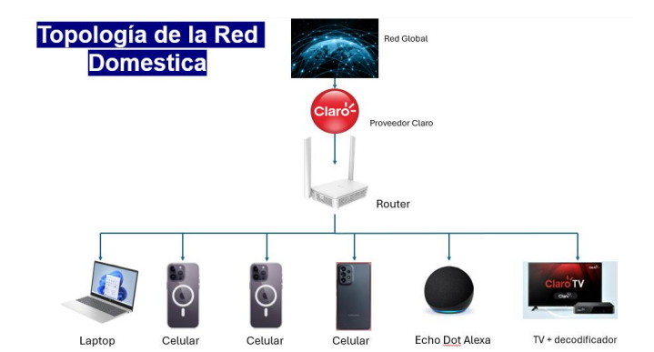
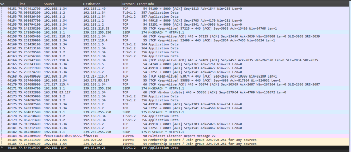

# 🏠 Home Network Security & Traffic Analysis

University group project adapted into a cybersecurity portfolio case study.

## Project Overview

This project documents the assessment of a real residential network. The work included device inventory, IPv4 addressing, DHCP, connectivity tests, wireless security, bandwidth measurements, Wireshark traffic analysis, redundancy, vulnerability identification and network topology.

Some identifying values from the original environment were redacted, but the screenshots below come from the real project.

## Original Network Topology

The network used a single router as the central point for Internet access and local connectivity. The connected devices included a laptop, mobile phones, a smart speaker and TV equipment.

## Wireshark Capture

This capture was taken during the project while reviewing traffic generated on the residential network. More packet captures and protocol notes are available in the [Wireshark analysis](./wireshark-analysis.md).

## Project Structure

| Section | Description |
|---|---|
| [Network Architecture](./network-architecture.md) | Network layout, IPv4, DHCP and Wi-Fi configuration |
| [Connectivity & Performance](./connectivity-tests.md) | Gateway, Internet, DNS and `tracert` tests |
| [Wireshark Analysis](./wireshark-analysis.md) | Packet captures and observed protocols |
| [Security Findings](./security-findings.md) | Segmentation, IoT and availability risks |
| [Recommendations](./recommendations.md) | Improvements proposed after the assessment |

## Environment

- Fiber Internet connection
- Wireless router providing routing, Wi-Fi and DHCP
- Laptop
- Three mobile devices
- Smart TV / set-top box
- IoT smart speaker

## Tools Used

- Wireshark
- Cisco Packet Tracer
- `ipconfig`
- `ping`
- `tracert`
- Speedtest

## Main Results

### Connectivity

The tests confirmed communication with the local gateway, Internet connectivity, DNS resolution and a complete route to an external destination.

### Wireless Security

The Wi-Fi connection used WPA2-Personal with CCMP on the 5 GHz band and IEEE 802.11ac.

### Performance

The documented Speedtest result was approximately:

- **155.20 Mbps download**
- **157.18 Mbps upload**
- **4 ms latency**

### Traffic Analysis

The packet captures included TCP, TLS 1.2, SSDP, IGMP and ICMPv6 traffic. During the capture period we did not identify an obvious malicious pattern.

## Main Security Findings

| Finding | Risk | Priority |
|---|---|---:|
| All devices on one LAN | A compromised device could communicate with other local systems | Medium |
| IoT devices on trusted LAN | Larger lateral exposure | Medium |
| Possible unnecessary WPS | Additional wireless attack surface | Medium |
| Router firmware maintenance | Potential exposure to unpatched issues | Medium |
| Single ISP/router dependency | Complete loss of connectivity during failure | Low |

The main improvement proposed was to separate IoT and multimedia devices from trusted endpoints using a guest network or VLAN when possible.

## Skills Practiced

- IPv4 and DHCP analysis
- Default gateway and DNS troubleshooting
- `ping` and `tracert`
- Wi-Fi security review
- Wireshark packet analysis
- Protocol identification
- Network segmentation concepts
- Basic risk assessment
- Technical documentation

## Project Context

This was completed as a university group project for a networking course. This portfolio version keeps the original technical evidence while removing personal or unnecessary identifying information.
